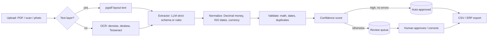

# Invoice & Document Data Extraction: demo project

> **Demo project, not client work.** All vendors, invoices and amounts in `samples/` are fictional and generated by `scripts/make_samples.py`.

Turns invoices (digital PDFs, scans, phone photos) into **validated, structured data** for a spreadsheet, database or accounting system. Errors are caught by business rules rather than silently imported. Anything uncertain goes to a **human review queue**.

## The business problem

Finance and operations teams re-type invoice data by hand: vendor, number, dates, line items, tax, totals. It's slow, and mistakes such as wrong totals or paying the same invoice twice cost real money. This pipeline automates the typing but keeps a person in charge of anything doubtful:

| Step | What happens |
| --- | --- |
| Load | Uses the PDF text layer when there is one. Otherwise OCR (Tesseract) with denoise, threshold and deskew |
| Extract | An LLM with a **strict JSON schema** (OpenAI structured outputs or Anthropic tool use), or an offline rule-based baseline |
| Normalize | Money as `Decimal` (never float), EU/US number formats, many date formats, ISO currency codes |
| Validate | Line math, subtotal, subtotal + tax = total, due date after issue date, unusual tax rate, missing fields, **duplicate invoice** (same vendor + number, or same file) |
| Score | Weakest required field × OCR quality − penalties for issues → 0–1 confidence |
| Route | No errors and confidence ≥ 0.85 → auto-approved. Everything else → review queue |
| Review & export | Approve, reject or correct in the queue; export approved rows to CSV (or push to an ERP via its API) |



## Quick start (offline, no API key)

```bash
pip install pydantic numpy pypdf pillow pytesseract reportlab pytest
# OCR system tools: Ubuntu `sudo apt install tesseract-ocr poppler-utils`, macOS `brew install tesseract poppler`

python scripts/make_samples.py          # (re)generate the fictional sample invoices
python -m ie.cli process samples/       # extract all 9
python -m ie.cli queue                  # see what needs a human
python -m ie.cli approve 4              # approve after checking
python -m ie.cli export > invoices.csv
python -m ie.cli eval                   # accuracy report
pytest -q
```

Example run:

```
[1] acme-cloud-INV-10421.pdf         auto_approved conf=0.9   text-layer Acme Cloud Services LLC | INV-10421 | 2026-10-03 | USD 451.44
[2] acme-cloud-INV-10421_resent.pdf  needs_review  conf=0.65  text-layer Acme Cloud Services LLC | INV-10421 | ...  !! duplicate
[4] acme-cloud-INV-10612.pdf         needs_review  conf=0.65  text-layer ...  !! total_mismatch (subtotal + tax = 1350.00, total is 1450.00)
[5] brightlane-RE-2026-0312.pdf      auto_approved conf=0.9   text-layer Brightlane Software GmbH | RE-2026-0312 | 2026-09-15 | EUR 4796.30
[8] harbour-print-HP-5602-scan.pdf   auto_approved conf=0.871 ocr        Harbour Print & Design Ltd | HP-5602 | 2026-10-29 | GBP 308.40
[9] indus-it-INV-2026-118.pdf        auto_approved conf=0.9   text-layer Indus IT Solutions (Pvt) Ltd | INV-2026-118 | 2026-10-28 | PKR 220400.00
```

## With an LLM and the API

```bash
pip install -r requirements.txt
cp .env.example .env            # set IE_PROVIDER=openai (or anthropic) and the API key
uvicorn app.api:app --reload    # or: docker compose up --build (includes Tesseract + poppler)
```

```bash
curl -X POST localhost:8000/v1/documents -H "X-API-Key: change-me" -F "files=@invoice.pdf"
curl localhost:8000/v1/review -H "X-API-Key: change-me"
curl -X POST localhost:8000/v1/review/4 -H "X-API-Key: change-me" -H "Content-Type: application/json" \
     -d '{"decision":"approved","reviewer":"ali"}'
curl localhost:8000/v1/export.csv -H "X-API-Key: change-me"
```

## Evaluation

**Labeled samples:** 9 invoices across 4 layouts (US, EU with comma decimals, UK, Pakistan). One is a noisy image-only scan, one has a wrong total and one is a re-sent duplicate.

| Metric | Offline rules |
| --- | --- |
| Header field accuracy | 100% |
| Line item accuracy | 100% |
| Documents fully correct | 9 / 9 |
| Routing accuracy (review when it should) | 100% |
| Unsafe auto-approvals | 0 |

**Held-out layout** (`samples_holdout/`, which the rules were never tuned on): the offline rules get **33% of fields right**. It is still routed to review with confidence 0.0, so **nothing wrong is auto-approved.**

**Read this honestly:** the offline extractor was written alongside these samples, so its 100% shows the pipeline works, not that rules generalize. Unfamiliar layouts are what the LLM mode is for. For client work: label 30–50 of the client's real documents first, run `python -m ie.cli eval` with `IE_PROVIDER=openai`, and report those numbers. CI enforces two gates: accuracy on the labeled set, and zero unsafe auto-approvals on unfamiliar layouts.

## Design choices worth noting

- **Money is never a float.** The LLM schema returns money as strings; parsing goes straight to `Decimal`.
- **The model never computes.** It copies printed values, and the validators do the arithmetic. A wrong total on the paper is caught, not silently "fixed".
- **Documents are untrusted input.** The extraction prompt tells the model to ignore instructions inside the document, and the output must match a strict schema.
- **Tenant isolation:** every query is scoped by `org_id`; API keys map to tenants.
- **Audit trail:** status, reviewer and timestamp per document. `db/schema.sql` adds a `corrections` table for production, which also becomes future eval data.

## Layout

```
ie/            core library
  loaders.py     text layer or OCR (denoise, deskew, Tesseract)
  extractors.py  OpenAI / Anthropic strict-schema extractors + offline rule baseline
  normalize.py   Decimal money, dates, currency
  validate.py    business rules + confidence score
  pipeline.py    load -> extract -> validate -> score -> route -> store
  store.py       SQLite store: review queue, approvals, CSV export
  evals.py       field, line-item and routing metrics
  cli.py         command-line demo
app/api.py     FastAPI: upload, review queue, approve/reject/correct, CSV export
db/schema.sql  PostgreSQL schema for production (+ corrections table)
scripts/make_samples.py   fictional invoice generator with ground-truth labels
tests/         26 pytest tests
```

## Verification status

| Part | Status |
| --- | --- |
| Loading, OCR, rules extractor, validation, routing, store, evals, CLI | Re-run 6 Nov 2026 with Tesseract 5.5.3: 26 pytest tests pass. Labeled eval: field accuracy 100%, line items 100%, 9/9 documents exact, routing 100%, unsafe auto-approvals 0 (7 auto-approved, 2 sent to review) |
| CLI review flow | `process samples/` then `queue` then `approve 4`. Approve cleared INV-10612; the duplicate stayed in the queue |
| Demo video | `demo-assets/invoice-extractor-demo.mp4` (1:42): process, queue, then approve |
| API handlers (upload, queue, review, export, auth, errors, tenant isolation) | Smoke-tested by calling the handlers directly; **not yet run under real FastAPI/uvicorn** |
| OpenAI / Anthropic extractors | Written against the official SDKs' structured-output / tool-use APIs. **Not called on this run:** no `OPENAI_API_KEY` was available. Re-run with `IE_PROVIDER=openai python -m ie.cli eval` and record those numbers |
| Dockerfile, `db/schema.sql` | Written, **not yet built or run** |

## Portfolio description (for Upwork)

> **Demo project: AI invoice data extraction with human review.** Turns PDFs, scans and phone photos of invoices into validated structured data. Uses OCR with image cleanup, LLM extraction with a strict JSON schema, Decimal-safe money handling, business-rule validation (totals, dates, duplicates) and a confidence-based review queue with CSV/API export. On the demo set it extracted 9/9 invoices correctly across US, EU, UK and Pakistani formats, caught the wrong total and the duplicate, and auto-approved zero bad documents. Repo: https://github.com/MujtabaJ/invoice-extractor. Review video (process, queue, approve): https://github.com/MujtabaJ/invoice-extractor/blob/main/demo-assets/invoice-extractor-demo.mp4. *(OpenAI eval numbers still to be added.)*
